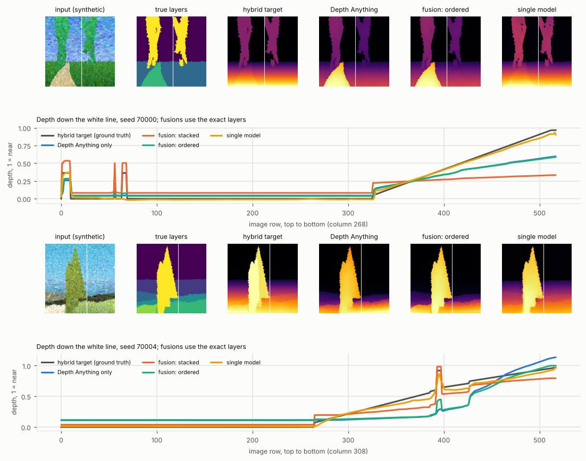
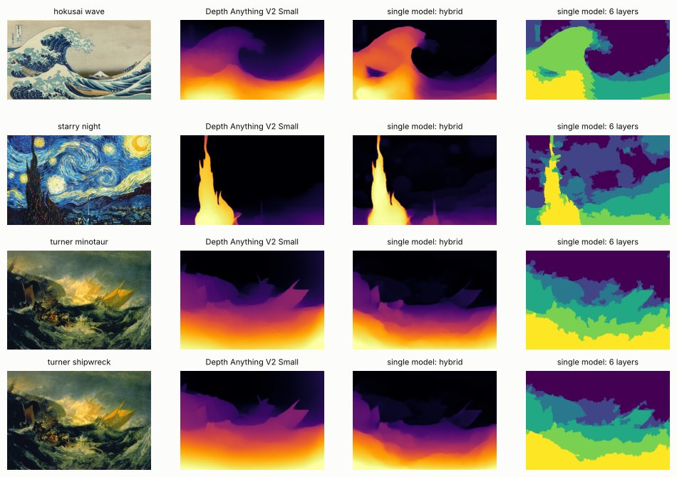

# Hybrid depth: artistic layers *and* continuous depth

Goal: one depth map that is **smooth inside each layer** (a road or a plain receding to the horizon) and **jumps
between layers in paint order** (a tree in front of the field behind it), like Illustrator's Depth.

*October 2026. The numbers below come from CPU experiments in the build environment (see "How these numbers were
made"). The Colab notebook [`03_hybrid_depth_poc.ipynb`](../notebooks/03_hybrid_depth_poc.ipynb) reruns everything
on a GPU, with the real Illustrator's Depth model added.*

## Summary

* **Combining the two models works only as well as the layer map.** With exact layers, every layer-aware fusion fixes
  layer ordering: boundary accuracy goes from 0.78 (Depth Anything alone) to 0.98–1.00. Depth inside layers stays exactly as good as
  Depth Anything's. With slightly wrong layer boundaries (±4 px, some merged layers), every method falls back to ~0.79.
* **No fusion can make depth inside a layer better than the depth model's own.** On painterly scenes Depth Anything
  V2 Small reaches a rank correlation of only 0.71 with the true depth inside layers. That is the ceiling for every
  two-model method.
* **"Ordered" is the best classical fusion for 3D/parallax.** It shifts each layer forward by the smallest amount that puts it in front of
  the layers it touches. "Stacked" (strict global layer order) is the right choice for Illustrator-style editing.
  Multiply and blend look fine on these scenes but guarantee nothing. Poisson costs ~100× more for no gain, and guided filtering does not fix ordering.
* **Re-predicting depth with occluders masked out did not pay off.** With exact layers it slightly improves hard-pair
  ordering, but continuity inside layers gets worse (0.67 vs 0.68 on the same scenes). With imperfect layers,
  boundary accuracy drops from 0.79 to 0.72. The filled regions read as flat paint to the depth model.
* **A single model can do both.** It is Depth Anything V2 Small with a two-channel head (hybrid depth + layer index),
  trained only on synthetic scenes with exact ground truth for 900 CPU steps. On held-out synthetic scenes it beats
  every fusion on continuity inside layers: 0.80 vs ≤ 0.71, and 0.74 vs 0.63 on road scenes. It also beats fusion
  with imperfect layers on boundary order (0.86 vs ~0.79). Only fusion with *exact* layers orders boundaries better
  (0.99). Caveat: it was tested on scenes from the same generator it was trained on, so real paintings are the open
  question.

## 1. What "hybrid depth" should mean

Inputs: a continuous depth map `d` (larger = closer) and a layer map `L` (larger = painted later = in front). Two
reasonable definitions disagree in one common case: a **mid-distance tree standing on a meadow that extends in front
of it**. The tree is painted after the meadow.

| Definition | Tree vs near meadow | Good for |
|---|---|---|
| **stacked** (lexicographic): `L` decides, `d` only orders pixels inside a layer | tree in front of the *whole* meadow | Illustrator-style editing, layer export |
| **ordered**: keep `d`, add one offset per layer, the smallest that puts every layer `margin` in front of the layers it *touches* | near meadow stays in front of the tree; tree is in front where it touches the meadow behind it | 3D photos, parallax, relief |

The synthetic ground truth (`layermap.synth`, `render(..., return_depth=True)`) has both: exact paint-order layers
and exact true depth. Flat plains and roads are ground planes, hills rise more steeply than the plane, and objects stand at the depth of their
base. At about 9% of boundary pixel pairs, paint order and true depth disagree, mostly where an object's base meets
the ground. The hybrid **target** used for training and scoring is `fusion.hybrid_target(depth, layers)`, i.e.
"ordered" applied to the ground truth.

## 2. Part 1: classical fusion of two models

### Methods (`layermap/fusion.py`)

| Method | What it does |
|---|---|
| multiply | `n(L) · n(d)` |
| blend | `0.5·n(L) + 0.5·n(d)` |
| stacked | `L + 0.8 · (d rescaled to [0, 1] inside each layer)` |
| ordered | `d + b[L]`; `b` is the minimal solution of "front minus back ≥ margin along every boundary" (exact via a longest path on the layer adjacency graph; robust to stroke spill through a low quantile) |
| poisson | screened Poisson: match `∇d` inside layers, enforce ordered jumps ≥ margin across boundaries |
| guided | guided filter of `d` with `L` as the guide image |
| masked | re-run the depth model once per layer with all layers in front of it removed (push-pull fill), align each prediction to the full-image one, then fuse |

### Metrics (`layermap/metrics.py::hybrid_metrics`)

* `acc_edge`: nearby pixel pairs in different layers, ordered like the **paint order**. Measures artistic layering;
  independent of the target definition.
* `rho_within`: Spearman correlation with **true depth inside each layer** that has real depth variation. Measures
  continuity, the road/plain criterion; also independent of the target definition.
* `acc_hard` and `ssi_mae`: against the hybrid target. `ordered` is favoured here because the target uses the same
  rule.

### Results: 40 synthetic painterly scenes (18 with a road), real Depth Anything V2 Small predictions

Layer source **exact** = ground-truth layers (an upper bound for a perfect layer predictor); **noisy** = ground-truth
layers with boundaries wobbled by ~4 px and 15% of adjacent layers merged (a stand-in for a real predictor; real
Illustrator's Depth numbers come from notebook 03).

| Method | layers | acc_edge ↑ | rho_within ↑ | acc_hard ↑ | ssi_mae ↓ |
|---|---|---|---|---|---|
| Depth Anything only | none | 0.782 | **0.714** | 0.677 | 0.425 |
| layers only | exact | 1.000 | 0.000 | 0.894 | 0.562 |
| multiply | exact | 0.998 | 0.713 | 0.884 | 0.435 |
| blend | exact | 0.999 | 0.713 | 0.875 | 0.426 |
| stacked | exact | **1.000** | 0.713 | **0.912** | 0.549 |
| ordered | exact | 0.992 | 0.713 | 0.818 | **0.401** |
| poisson | exact | 0.984 | 0.695 | 0.775 | 0.416 |
| guided | exact | 0.879 | 0.708 | 0.696 | 0.417 |
| multiply | noisy | 0.791 | 0.674 | 0.816 | 0.458 |
| stacked | noisy | 0.767 | 0.663 | 0.833 | 0.561 |
| ordered | noisy | 0.797 | 0.700 | 0.770 | 0.402 |
| poisson | noisy | 0.810 | 0.696 | 0.754 | 0.419 |

Masked re-prediction, measured on the first 20 scenes and compared with the same 20:

| Method | layers | acc_edge ↑ | rho_within ↑ | acc_hard ↑ | ssi_mae ↓ |
|---|---|---|---|---|---|
| Depth Anything only | none | 0.775 | **0.684** | 0.658 | 0.465 |
| masked Depth Anything | exact | 0.779 | 0.670 | 0.696 | 0.467 |
| ordered | exact | **0.992** | **0.684** | 0.798 | 0.442 |
| masked + ordered | exact | 0.989 | 0.669 | **0.808** | **0.436** |
| ordered | noisy | 0.792 | 0.671 | 0.767 | 0.448 |
| masked + ordered | noisy | 0.718 | 0.638 | 0.774 | 0.457 |

### Takeaways

1. **Fusion fixes order, not shape.** Every layer-aware method lifts boundary ordering to ≈1.0 with exact layers, and
   none moves `rho_within` above Depth Anything's own 0.714. The inside-layer depth is only as good as the depth model.
2. **The layer map's boundaries are the bottleneck.** A few pixels of boundary error cost ~0.2 of boundary accuracy,
   whichever fuser is used. With real Illustrator's Depth this is the thing to check: its README warns about textured inputs.
3. **Pick by use.** `stacked` for editing (global layer order); `ordered` for parallax and 3D (closest to physical depth,
   a 30-line, millisecond algorithm). `multiply` is a reasonable quick look, with no guarantee.
4. **Not worth it:** Poisson (seconds per image, no gain), guided filter (does not reorder), masked re-prediction
   (K extra passes, worse).

## 3. Part 2: one model with both behaviours

### Design

* **Network:** Depth Anything V2 Small, with the final 1×1 convolution widened to two output channels (both initialised
  from the pretrained channel; `model.make_multi_head`).
  * channel 0, `hybrid`: trained on `hybrid_target(true depth, layers)`
  * channel 1, `layer`: trained on the paint-order layer index, so discrete layers can still be exported
* **Loss per channel:** scale/shift-invariant L1 + multi-scale gradient matching + pairwise ranking. Gradient matching
  is what rewards "flat gradient inside, sharp step at the edge".
* **Data:** `generate_dataset(..., with_depth=True)`, synthetic only. **No teacher model**: training on Illustrator's
  Depth (or on fused ID + DA outputs) would inherit Adobe's non-commercial licence (`docs/PLAN.md` §3).
* **Training:** `TrainConfig(targets=["hybrid", "layer"])`, from notebook 03 or 02, or
  `python -m layermap.train --targets hybrid layer ...`.

### Result: 900 training steps on CPU (322 px crops, batch 4, 1,200 synthetic scenes)

Same 40 held-out scenes as Part 1 (different seeds from training).

| Method | acc_edge ↑ | rho_within ↑ | acc_hard ↑ | ssi_mae ↓ | rho_within, road scenes ↑ |
|---|---|---|---|---|---|
| Depth Anything only | 0.782 | 0.714 | 0.677 | 0.425 | 0.628 |
| ordered fusion, exact layers (upper bound) | **0.992** | 0.713 | 0.818 | 0.401 | 0.626 |
| stacked fusion, exact layers (upper bound) | 1.000 | 0.713 | **0.912** | 0.549 | 0.626 |
| ordered fusion, noisy layers (realistic) | 0.797 | 0.700 | 0.770 | 0.402 | 0.618 |
| **single model, hybrid channel** | 0.861 | **0.798** | 0.838 | **0.125** | **0.742** |
| single model, layer channel | 0.906 | 0.480 | 0.905 | 0.520 | 0.489 |

What this shows, and what it does not:

* **Inside layers the single model is better than any fusion can be.** Fusions are capped by the depth model, but the
  single model *learned* depth on painterly input. In the profile plot below, its curve follows the road's true slope
  while both fusions inherit Depth Anything's flattened slope.
* **At layer boundaries it sits between the realistic and the ideal fusion.** It reaches 0.86, against 0.79 with
  imperfect layers and 0.99 with exact ones. More training, higher resolution or the layer-query decoder below should
  close this.
* **`ssi_mae` (0.125) is flattering.** The model was trained on exactly this target from the same generator. Read it
  as "it learned the definition", not as accuracy on paintings.
* **The layer channel** orders boundaries better than the hybrid channel (0.91), and quantised into a few layers it
  gives editable layers without a second model.
* **On real paintings (second figure) the changes from Depth Anything are modest.** Turner's seascapes look much the
  same. In Hokusai's *Great Wave* the wave is pulled in front of the sky and Mount Fuji, as paint order says it should
  be. In *Starry Night* the layer channel fragments the swirling sky. Real-painting quality is unmeasured until there
  are labelled paintings.
* **No control run yet.** One open question is how much of the continuity gain comes simply from adapting depth to
  painterly images. Fine-tuning on true depth alone and then fusing would answer it. The notebook makes that a
  one-line change (`targets=["depth"]`).

### Where this could go next (research notes)

* **Closest prior work.**
  * [Layered Depth Refinement with Mask Guidance](https://openaccess.thecvf.com/content/CVPR2022/papers/Kim_Layered_Depth_Refinement_With_Mask_Guidance_CVPR_2022_paper.pdf)
    (Kim et al., CVPR 2022, Adobe) refines depth inside and outside one mask. It is the learned version of "masking
    areas from Illustrator's Depth".
  * [MoDOT](https://arxiv.org/abs/2505.21231) (2025) predicts depth and occlusion boundaries jointly and finds the two
    tasks help each other, which supports the two-channel design.
  * 3D Ken Burns (Niklaus et al., TOG 2019) adjusts depth with segmentation so objects stay coherent.
* **If the two-channel head blurs layer edges,** the next architecture is a *layer-query decoder*. It predicts N layer
  masks plus a small parametric depth field per layer (e.g. a plane or low-order polynomial). That gives exactly
  "discrete layers with continuous depth inside", and the synthetic generator already provides the per-layer
  ground truth. Bin-based depth heads (AdaBins-style) are another way to mix discrete and continuous outputs, but
  their bins are depth intervals, not paint-order layers.
* **Data realism is the main lever for both approaches.** That means more painting styles in the generator and a
  small hand-labelled set of real paintings.

## How these numbers were made

* The build environment could reach GitHub but not Hugging Face or Google Drive, and had no GPU:
  * Depth Anything V2 Small was rebuilt from a GitHub-hosted ONNX export of the official Apache-2.0 weights,
    converted back to PyTorch (max output difference 3e-6 vs the ONNX model).
  * Illustrator's Depth (weights on Google Drive) could not be run. Part 1 therefore uses exact and noisy layer maps,
    and notebook 03 adds the real model.
* The scenes were rendered at 518 px, seeds 70000–70039. The masked rows use the first 20 scenes and are compared with
  the same 20.
* These are synthetic painterly scenes, not real paintings. They measure the mechanism, not the final quality on
  Impressionist art. Real paintings are judged by eye in the notebook (profiles, parallax GIFs) until you have
  hand-labelled ones.
